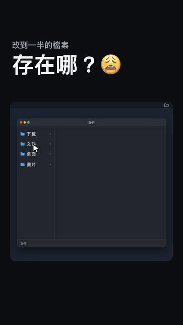

# 迷你 Finder

一個浮在 Mac 螢幕角落的小面板。你切到哪個檔案，它就跳到那個檔案所在的資料夾，要打開、拖去上傳、找同資料夾的其他檔案，都不用再開 Finder 一層層點。

<p align="center"></p>

## 為什麼做這個

我常常改檔案改到一半，想拖去上傳或寄出，才發現不知道它存在哪個資料夾，只好打開 Finder 從頭點：文件、客戶、品牌、2026、10月、素材……

## 功能

| 功能 | 怎麼用 |
|---|---|
| 自動跟隨 | 切到任何開著檔案的視窗，面板會在一秒內換成那個檔案的資料夾，正在編輯的檔案會標粗體 |
| 打開檔案 | 雙擊檔案用預設程式打開；雙擊資料夾就進去看 |
| 拖曳 | 把檔案從面板直接拖進網頁上傳區、信件或其他程式 |
| 排序 | 點右上角工具列最左邊的按鈕，在「依名稱」和「依修改時間」之間切換，剛改過的排第一 |
| 上層資料夾 | 點資料夾名稱，列出每一層上層資料夾，點了就跳過去；也可以按「上一層」 |
| 收合 | 雙擊面板標題區，只留資料夾名稱和狀態列；再雙擊展開 |
| 右鍵選單 | 打開、在 Finder 中顯示、拷貝路徑（可多選） |
| 暫停跟隨 | 點定位按鈕關掉自動跟隨，面板就停在目前的資料夾 |
| 選單列圖示 | 顯示／隱藏面板、設定登入時自動開啟、結束程式 |

面板會出現在每個桌面空間和全螢幕程式上，位置、大小、排序方式、收合狀態都會記住。

## 系統需求

- macOS 13 以上
- Xcode 命令列工具（沒裝過的話，在終端機執行 `xcode-select --install`）

## 安裝

```bash
git clone https://github.com/Liiiiwei/mini-finder.git
cd mini-finder
./build.sh
open ~/Applications/迷你\ Finder.app
```

`build.sh` 會編譯 `MiniFinder.swift`，把程式裝到 `~/Applications/迷你 Finder.app`。

第一次打開會跳出系統詢問，請到「系統設定 → 隱私權與安全性 → 輔助使用」打開「迷你 Finder」。沒有這個權限，面板讀不到你正在編輯哪個檔案。還沒開權限時，面板中間會有「打開輔助使用設定」按鈕，按下去直接跳到那一頁；開好後按鈕自己消失，不用重開程式。要用「登入時自動開啟」，系統會再問一次是否允許控制「System Events」。

### 重新編譯後不想重勾權限

macOS 是依簽名認程式的。預設的臨時簽名每次編譯都會變，系統會當成新程式，輔助使用權限要重勾一次。

如果你有 Apple 開發者憑證，把憑證名稱寫進專案資料夾的 `.sign-identity`，之後每次編譯都用同一張憑證簽名，權限就不會掉：

```bash
security find-identity -v -p codesigning   # 查你的憑證名稱
echo "Apple Development: 你的名字 (XXXXXXXXXX)" > .sign-identity
```

`.sign-identity` 已列在 `.gitignore`，不會被提交。

## 運作方式

每秒讀一次最前面視窗的文件路徑（輔助使用介面的 `AXDocument` 屬性），路徑變了就換資料夾；同一個資料夾裡的檔案有增減或修改，清單也會跟著更新。

程式只讀本機的檔案清單，不連網路，也不記錄你開過哪些檔案。

## 已知限制

- 程式本身沒有提供文件路徑的編輯器，面板不會跟著跳。實測 Antigravity 不行；文字編輯、預覽程式、Illustrator 都可以。
- 只顯示一層資料夾內容，不展開子資料夾。
- 不顯示隱藏檔。

## 介紹短片

`promo/` 是上面那段動畫的原始檔。畫面不是錄螢幕，是用 HTML 依時間一格一格畫出來，再接給 ffmpeg 輸出成 1080×1920 的影片。

```bash
cd promo
npm install
node record.mjs promo-v2.html video 迷你Finder-介紹-9x16-v2.mp4 21
```

需要 Google Chrome 和 ffmpeg。儲存庫裡已附上輸出好的 `promo/迷你Finder-介紹-9x16-v2.mp4`，每輪檢查的問題和修法記在 `promo/checks.md`。

## 作者與著作紀錄

- 作者：Liwei Sia（[hi@liweisia.com](mailto:hi@liweisia.com)）
- 首次完成：2026 年 10 月 28 日
- 開發方式：需求、實機測試和每一版要怎麼改由我決定，程式碼請 Claude 用 Swift 寫

| 日期 | 版本 | 內容 |
|---|---|---|
| 2026-10-28 | 第一版 | 浮動面板跟隨目前編輯中檔案的資料夾；雙擊打開、拖曳、右鍵選單、選單列圖示、登入時自動開啟 |
| 2026-10-28 | 第二版 | 改成自訂介面，面板寬 240 |
| 2026-10-28 | 第三版 | 依修改時間排序、雙擊標題區收合、圖示對齊 |
| 2026-10-28 | 簽名 | 改用固定憑證簽名，重新編譯不必重勾權限 |
| 2026-10-28 | 權限按鈕 | 還沒開輔助使用權限時，面板顯示按鈕直接打開系統設定 |
| 2026-10-28 | 介紹短片 | 21 秒 9:16 動畫，用程式逐格輸出 |

之後的修改紀錄以本儲存庫的 git 提交紀錄為準。

## 授權

[MIT](LICENSE) © 2026 Liwei Sia。可以自由使用、修改、再發布，但要保留原作者的著作權聲明。
